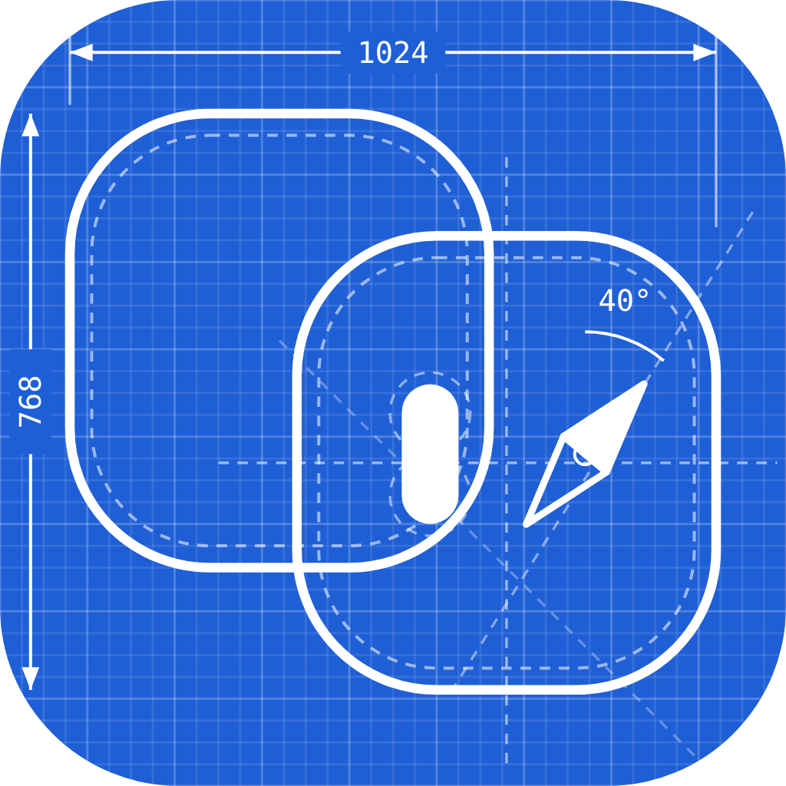
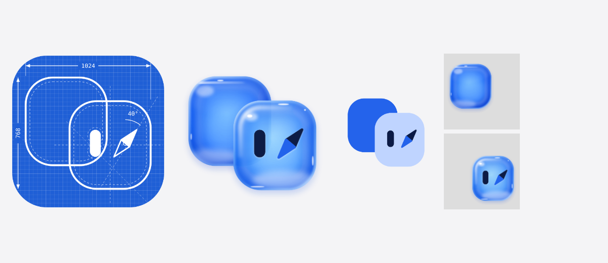

# Pane app icons: handoff

Yab is being renamed **Pane**. This folder holds the approved app icon set,
ready to wire into the icon switcher. Design is done; nothing here touches
`Icon/` or the Swift code yet.

Design canvas (all rounds, for context):
https://claude.ai/artifact/Eq3hv8Bf2JdVdFnmjAwzTq. The "Cobalt, and
friends" board is the final set.


## The set

| Slug | Title | Tile | Dark tile | Notes |
| --- | --- | --- | --- | --- |
| `peek` | Peek | `#F3F6FE` | `#0E1530` | **Default.** Two overlapping panes; the front one has a pill eye and a compass-needle eye. |
| `solo` | Solo | `#F3F6FE` | `#0E1530` | One cobalt pane, white pill and needle. Boldest at 16 px. |
| `two-pills` | Two Pills | `#F3F6FE` | `#0E1530` | Peek with two pill eyes, no needle. |
| `inverse` | Inverse | `#2463EB` | — | Solo with colors flipped. |
| `midnight` | Midnight | `#0E1530` | — | Peek on a navy tile, in both appearances. |
| `stack` | Stack | `#F3F6FE` | `#0E1530` | Three panes stepping up like tabs, face on top. |
| `old-friend` | Old Friend | `#F5F5F1` | `#141415` | **Yab look-alike, see Legal below.** |

Palette: navy `#0B1A45` (features), cobalt `#2463EB`, deep cobalt `#1645B8`,
pale `#BFD4FF`, light tile `#F3F6FE`, midnight `#0E1530`. The needle always
points northeast (rotated 40°): navy north half, cobalt south half.

## Pane Dev



`pane-dev.icon` replaces `Icon/yab Dev.icon`, the icon `./build.sh` puts on
a build that isn't going out (`build.sh`, around line 311). Like Yab Dev's,
it is a blueprint of the mark: Peek's two panes drawn in outline on cobalt
`#1F5FD6`, with a grid, construction lines and dimensions. One layer,
`blueprint.png` (1024 px), with `blueprint.svg` as its source; it is a PNG
because Icon Composer doesn't draw SVG text reliably.

## The standalone figure (welcome page)



`figure/` holds Peek without a tile, on a transparent ground, 1254 × 1254 px
like `Icon/Mark.png`:

- `pane-mark.png`: the glass rendering for the welcome page, in place of
  `Icon/Mark.png` (used by `Design.swift` `Logomark` and the welcome hero).
- `pane-mark-back.png` and `pane-mark-front.png`: the same figure split into
  its back pane and its front pane with the face, in place of
  `Icon/MarkBack.png` and `Icon/MarkFront.png`, which the welcome intro
  animates as two glasses (`WelcomeHero.swift`, `enum Glass`).
- `pane-mark-flat.png`: the flat version, for small or single-color uses.

Unlike Yab's cut-out `MarkBack.png` and `MarkFront.png`, both halves share one
canvas, so they line up when stacked at the same origin. `enum Glass` has
poses, sizes and a box fitted to Yab's art (`box`, `size`, `frontSize`,
`back`, …); those numbers need refitting to these pictures.

## Files

- `<slug>.icon/`: an Icon Composer document in the same shape as
  `Icon/Alternates/07-flat.icon`. `icon.json` sets the tile as the fill (with a
  dark-appearance fill where there is one) and one group per layer, top first.
  `Assets/*.svg` are the layers (`back`, `front`, `face`, …) at 1024 × 1024,
  no glass, no shadow. Open these in Icon Composer to tune glass/shadow if wanted.
- `previews/<slug>.svg|png` and `previews/<slug>-dark.svg|png`: flattened
  1024 px renders with the rounded tile, for picker previews and docs.
- `contact-sheet.png`: everything at a glance.
- `tools/generate.py`: the single source for every shape and color. Edit it,
  then regenerate (run from the repo root):

  ```bash
  python3 -I design/pane-icons/tools/generate.py design/pane-icons
  ```

  ```bash
  node design/pane-icons/tools/render.js design/pane-icons
  ```

  Pane Dev and the figure come from `tools/generate_extras.py` and
  `tools/render_extras.js`, run the same way.

  The SVGs use the design canvas's 100-unit grid with `viewBox="5 4 90 90"`
  (the tile square), so coordinates match the canvas files one to one.

## Wiring it in (for the next session)

The switcher already exists. It is driven by `AppIconCatalog`
(`Sources/SyncKit/AppIconCatalog.swift`): each case has a stable id, a
`title`, an iPhone `alternateName`, a `previewName` and an `artworkPath`
under `Icon/`. `Sources/Fast/AppIcons.swift` applies the choice. The owner
will decide how to wire it; things to know:

- Every current catalog icon (Flat, Default, Opal, the Halloween set, the
  friend/reward icons, Best Friends) is Yab artwork and a Yab trademark. A
  distributed Pane should replace them, not add to them.
- Native alternate names are stable identifiers (`YabOriginal`, …); new ones
  should be `Pane…` (`PanePeek`, `PaneSolo`, …).
- Run the icon suites after the change: `swift test --filter IconPickerTests`,
  `swift test --filter AppIconSyncTests`, `swift test --filter IconsTests`.
- AGENTS.md rules apply: settings rows go in `NativeActions.swift`, menu
  actions in the command field.

## Legal

Yab's code is Apache-2.0, but its name, logo and app icons are trademarks
(`TRADEMARKS.md`, `NOTICE`). A distributed fork needs its own name, its own
icon, a new bundle identifier and its own update feed. `TRADEMARKS.md` lists
"look-alike icons" as something a fork must not ship.

`old-friend` is deliberately Yab-styled (cyan, pill eye, wink, cheek, tilt).
The owner has said they will handle the legal side; do not ship it in a
distributed build until that is settled. Every other icon in this set is
original to Pane.
